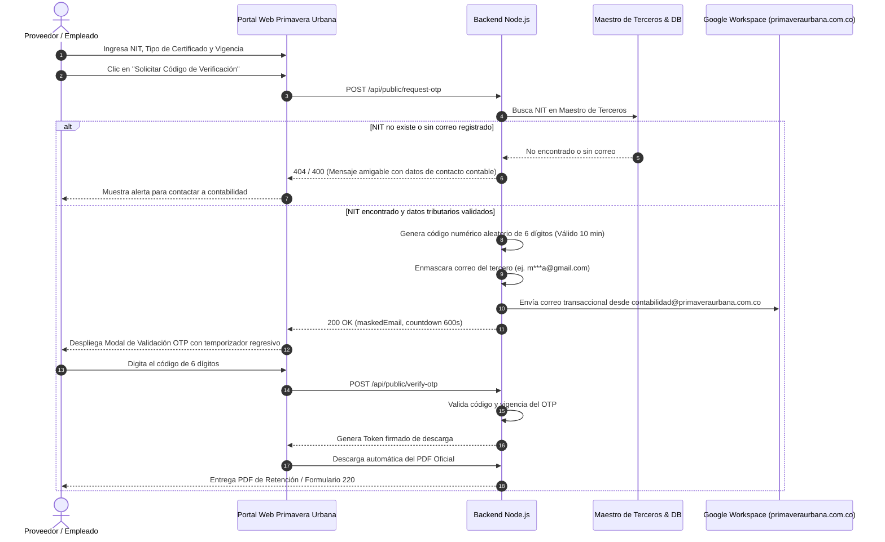

# Plataforma Web Autogestionable para Certificados Tributarios
### Copropiedad Comercial Primavera Urbana Centro Comercial y Empresarial • Villavicencio (Meta, Colombia)

> **Perfil Técnico del Sistema:** Desarrollador Full-Stack Senior experto en bases de datos relacionales, procesamiento de archivos Excel, envío de correos transaccionales y diseño UX/UI minimalista.

Plataforma web ligera, robusta y de alta seguridad diseñada para la autogestión de certificados tributarios oficiales (Retención en la Fuente por Renta, IVA, ICA) y Certificados de Ingresos y Retenciones (Formulario Oficial 220 de la DIAN) para proveedores y colaboradores de Primavera Urbana, incorporando un flujo estricto de autenticación mediante códigos de un solo uso (**OTP - One Time Password**) enviados a los correos registrados en el Maestro de Terceros.

---

## 🚀 Despliegue en Red Local (Dirección IP) y Servidor Host

El servidor se encuentra activo y escuchando en todas las interfaces de red (`0.0.0.0:3000`):
- **Acceso por Red Local (Dirección IP):** [http://172.20.20.110:3000](http://172.20.20.110:3000)
- **Acceso Local (Este equipo):** [http://localhost:3000](http://localhost:3000)
- **Módulo Privado (Panel Contable Administrativo):** [http://172.20.20.110:3000#admin](http://172.20.20.110:3000#admin)
- **Habilitación de Red Local (Firewall):** Incluye el script ejecutable `scripts/habilitar_firewall.bat` para autorizar el tráfico del puerto TCP 3000 en Windows Defender Firewall para todos los equipos de la red.
- **Credenciales Iniciales de Administrador:**
  - **Usuario:** `admin`
  - **Contraseña:** `admin1234`
  - **Protocolo de Seguridad:** Autenticación mediante Tokens Cifrados **JWT / NextAuth Compatible** con revocación y timeout automático por inactividad.

Para iniciar el servidor manualmente en cualquier momento:
```bash
cd "C:\Users\coord.contabilidad.CCPRIMAVERA\.gemini\antigravity\scratch\portal-certificados-tributarios"
npm start
```

---

## 🔐 Nuevo Flujo de Seguridad OTP (Autenticación de Terceros)

Para proteger los datos fiscales y financieros de los proveedores y colaboradores, el portal implementa el flujo de verificación OTP:



### Reglas del Módulo OTP:
1. **Verificación contra Base de Datos:** Al presionar *"Solicitar Código de Verificación"*, se valida que el NIT figure en el Maestro de Terceros y cuente con correo electrónico institucional, además de verificar la existencia de certificados para el año gravable.
2. **Mapeo y Envío:** Se enmascara la dirección de correo (ejemplo: `m***a@gmail.com`) y se despacha el código aleatorio de 6 dígitos mediante la cuenta oficial de **Google Workspace** (`contabilidad@primaveraurbana.com.co` bajo el dominio `primaveraurbana.com.co` vía SMTP SSL `smtp.gmail.com:465`).
3. **Interfaz de Validación:** Modal responsivo con cuenta regresiva de **10 minutos**, soporte para reenvío de código y modo asistido para entornos de prueba.
4. **Descarga e Inconsistencias:** Al validar el código, el navegador desencadena la descarga inmediata del documento PDF. Si el tercero no está registrado o carece de correo, el sistema muestra un mensaje claro con las vías de contacto del departamento de contabilidad de la copropiedad.

---

## 🛠️ Requerimientos Técnicos y Stack

- **Frontend:** HTML5 semántico, Tailwind CSS (Paleta institucional: Verde Bosque `#234923`, Dorado `#C5922C`, Rojo Rubí `#B31F24`, Neutral `#F4F7F6`), Vanilla JS reactivo y accesible.
- **Backend:** Node.js con Express 5.x y arquitectura modular de rutas y controladores.
- **Seguridad de Acceso:** Tokens cifrados **JWT (JSON Web Tokens)** con firma criptográfica `HS256`, expiración configurable y compatibilidad con arquitecturas **NextAuth**.
- **Servicio de Emailing Transaccional:** Integración oficial con **Google Workspace** (`contabilidad@primaveraurbana.com.co` en el dominio `primaveraurbana.com.co`) mediante protocolo SMTP seguro (`smtp.gmail.com:465` SSL) con `nodemailer`, autenticación por Contraseña de Aplicación de 16 caracteres y fallback transparente para pruebas locales.
- **Generación de PDF Oficiales:**
  - Librerías recomendadas: **`@react-pdf/renderer`** y **`pdfmake`** (utilizado en el motor backend para renderizado vectorial nítido con tipografía Helvetica, tablas contables y resoluciones normativas completas).
- **Procesamiento de Archivos Excel / CSV:** **`xlsx` (SheetJS)** con validación estricta de encabezados, sanitización de caracteres y cálculo automático de valores positivos absolutos (BASE y VALOR).
- **Base de Datos:** Persistencia relacional estructurada por vigencias (`store.json` con transacciones atómicas).

---

## 📁 Estructura del Proyecto

```
portal-certificados-tributarios/
├── package.json                   # Dependencias (express, jwt, bcryptjs, xlsx, pdfmake, nodemailer)
├── server.js                      # Punto de entrada y servidor Express (Puerto 3000)
├── config.js                      # Variables de entorno (JWT, Google Workspace SMTP, OTP Expiration)
├── database/
│   ├── db.js                      # Motor de datos, Maestro de Terceros y Gestor OTP
│   ├── seed.js                    # Población inicial de administrador, datos demo y maestro
│   └── data/
│       └── store.json             # Almacén de base de datos relacional
├── services/
│   ├── emailService.js            # Integración con Google Workspace SMTP, plantillas HTML y enmascaramiento
│   ├── excelParser.js             # Parser de Retenciones, Formulario 220 y Maestro de Terceros
│   ├── templateGenerator.js       # Generador de plantillas .xlsx oficiales descargables
│   ├── pdfService.js              # Generación de PDFs oficiales
│   ├── numberToWords.js           # Conversor de valores a letras en pesos colombianos (COP)
│   └── pdfTemplates/
│       ├── retencionTemplate.js   # Certificados Renta, IVA, ICA (Art. 381 E.T., % Retención, Firma Autorizada)
│       └── formulario220Template.js # Réplica oficial idéntica del Formulario 220 DIAN (Guía 2026, 1 sola página)
├── scripts/
│   └── habilitar_firewall.bat     # Script de configuración de regla de entrada en Firewall de Windows
├── middleware/
│   ├── auth.js                    # Middleware de seguridad JWT para rutas /admin
│   └── upload.js                  # Manejo de carga de archivos en memoria con Multer
├── routes/
│   ├── publicRoutes.js            # Endpoints OTP (request-otp, verify-otp, download-pdf)
│   ├── authRoutes.js              # Autenticación administrativa JWT (login, verify)
│   ├── adminRoutes.js             # Carga masiva, Maestro de Terceros, Fechas y Configuración
│   └── recordsRoutes.js           # Explorador y eliminación de vigencias
└── public/
    ├── index.html                 # Portal SPA con Landing OTP y Panel Administrativo
    ├── logo.png                   # Logotipo oficial de Copropiedad Comercial Primavera Urbana
    ├── css/styles.css             # Estilos corporativos y componentes visuales
    └── js/
        ├── api.js                 # Cliente API REST con soporte OTP y JWT
        └── app.js                 # Controlador del frontend, modales y temporizador OTP
```

---

## 📊 Estructuras de Archivos Soportadas

### 1. Maestro de Terceros (Proveedores y Empleados con Correo OTP)
*Columnas requeridas:*
1. `NIT` (Cédula o NIT sin puntos ni guiones)
2. `Razón Social / Nombre` (Nombre completo del tercero)
3. `Correo Electrónico` (Dirección donde se despacha el código OTP)
4. `Tipo de Tercero` (`Proveedor`, `Empleado` o `Ambos`)

### 2. Certificados de Retención Tributaria (Proveedores)
*Columnas requeridas:*
1. `NIT`
2. `TIPO DE CERTIFICADO` (`RENTA`, `IVA`, `ICA`)
3. `CUENTA`
4. `NOMBRE`
5. `DESCRIPCION` (Incluyendo tarifa como `4%`, `15% del IVA`, `10 x 1.000`)
6. `AÑO`
7. `BASE` (Se convierte a valor positivo absoluto)
8. `VALOR` (Se convierte a valor positivo absoluto)

### 3. Certificado de Ingresos y Retenciones (Formulario 220 DIAN)
*42 columnas exactas de la normatividad tributaria colombiana (Art. 378 E.T.).*

---

## ⚖️ Cumplimiento Legal y Normativo

- **Artículo 381 del Estatuto Tributario:** Expedición de certificados de retención en la fuente por conceptos de Renta, IVA e ICA.
- **Artículos 10 del Decreto 836 de 1991 y 7 del Decreto 380 de 1996:** Recopilados en el Decreto Único Reglamentario 1625 de 2016 (Arts. 1.6.1.12.12 y 1.6.1.12.13), indicando explícitamente que el documento no requiere firma autógrafa para su plena validez jurídica.
- **Habeas Data y Seguridad:** Autenticación OTP por correo registrado previo a la revelación de datos económicos privados.
